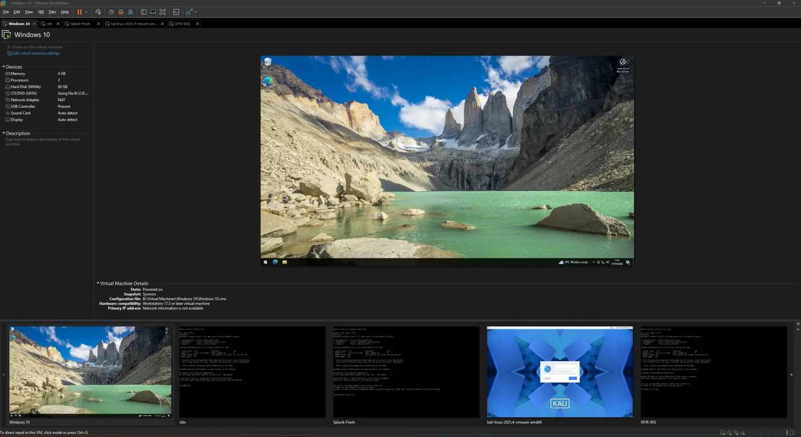
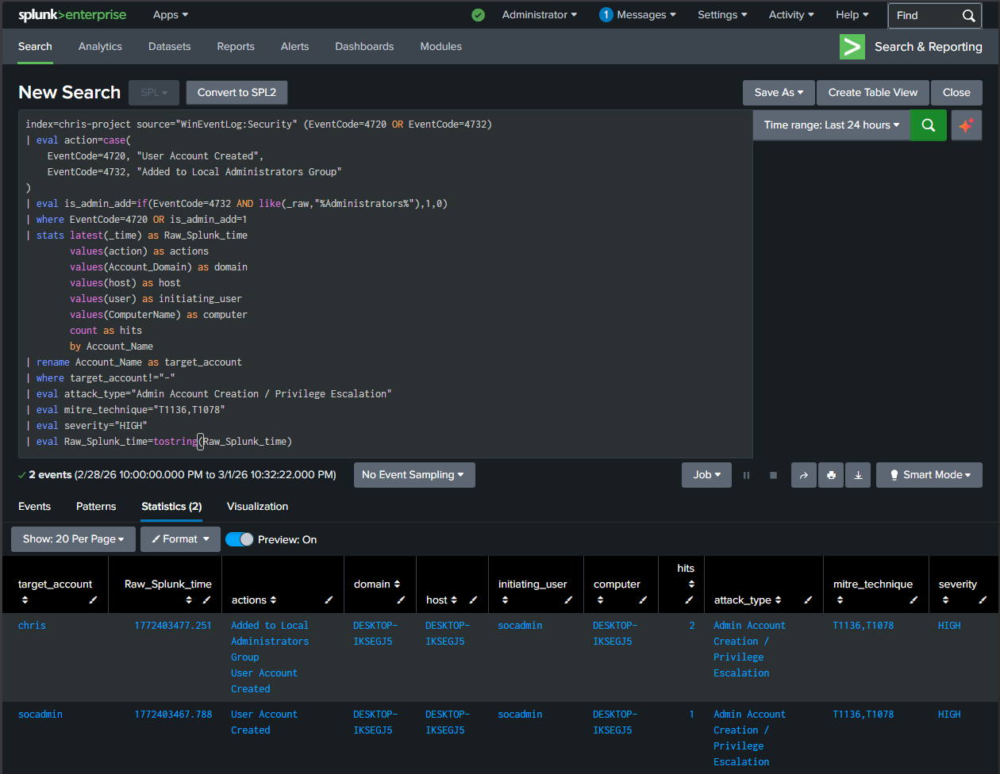
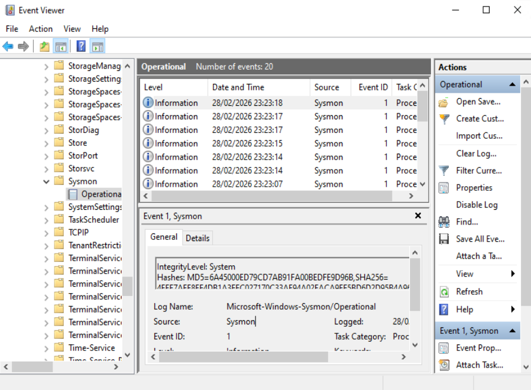

# SOC Automation Pipeline

Alert enrichment, structured triage and analyst handoff.

`Splunk → n8n → OpenAI + threat intelligence → DFIR-IRIS → Slack`

A compact SOC automation project that brings Windows telemetry, indicator enrichment and case management into one readable workflow. Alerts keep their original source and event time as they move from detection to a structured advisory, a case record and an analyst notification.

[Setup](SETUP.md) · [Detection queries](DETECTIONS.md) · [Walkthrough](WALKTHROUGH.md) · [Workflow export](workflows/soc-pipeline.json) · [MIT license](LICENSE)

## Pipeline architecture


Six stages separate collection, normalization, analysis, validation, case creation and notification. The enrichment tools use indicators from the incoming alert; the report formatter checks the model response before preparing downstream requests. [Open the full-size diagram](images/pipeline.svg).

## Engineering focus

| Area | Implementation |
|---|---|
| Alert intake | Five authenticated webhook paths feed one normalizer |
| Traceability | Preserve the Splunk SID, source host and timezone-qualified event time |
| Indicator handling | Validate public IPv4 and SHA-256 values before lookup |
| Report quality | Reject malformed JSON, unexpected fields and invalid scores |
| Severity | Calculate the final severity deterministically from validated scores |
| Case handoff | Prepare IRIS alert and escalation payloads; route High/Critical notifications to Slack |
| Configuration | Keep credentials in n8n and retain TLS certificate validation |

## Pipeline in action

### n8n orchestration


The canvas brings the input routes, model tools and downstream services into one view. The current export adds a shared normalization step ahead of analysis. [Full-size canvas](images/workflow-canvas.png).

### Slack notification


A notification puts the alert summary and investigation context in front of an analyst. In this workflow, the High/Critical branch follows the IRIS escalation request. [Full-size notification](images/slack-notification.png).

### DFIR-IRIS case


The case view gathers the alert narrative, severity and tags for review. The formatter carries the incoming event time and source SID into the alert payload. [Full-size case](images/dfir-iris-case.png).

### DFIR-IRIS queue


The queue shows how several investigations appear together with their opening dates, client and tags. [Full-size queue](images/dfir-iris-cases-list.png).

## Lab environment

The five-machine layout separates endpoint telemetry, detection, orchestration, case management and controlled test traffic.

| Machine | Responsibility |
|---|---|
| Windows endpoint | Security events, Sysmon process records and firewall logs |
| Splunk server | Search, aggregation and webhook alert delivery |
| n8n server | Input normalization, model/tool coordination and report validation |
| DFIR-IRIS server | Alert intake, case escalation and investigation records |
| Kali Linux | Authorized, lab-only scenario generation |



[Full-size machine overview](images/vmware-lab-overview.png).


The network editor distinguishes host-only and NAT segments. Keep test traffic within the approved lab and control orchestration-server egress to external APIs. [Full-size network settings](images/vmware-network-config.png).

## Three ways to study the pipeline

| Approach | Investigation path | Question to examine |
|---|---|---|
| Manual triage | Analyst searches events and queries intelligence services directly | What work does an analyst perform without orchestration? |
| Model-assisted triage | Structured alert feeds model analysis without enrichment tools | What context can be derived from the alert alone? |
| Enriched orchestration | Model analysis can query validated indicators, then hand off to IRIS and Slack | Does added intelligence improve the usefulness of the case? |

The included export implements the enriched orchestration path. The other two approaches are comparison designs, not additional workflow exports. For an evaluation, use the same alert set and retain timings, tool traces and analyst scoring separately for each approach.

## Detection scenarios

| Scenario | Telemetry | Input route |
|---|---|---|
| Repeated authentication failures | Windows Security event 4625 | IP |
| Process hash review | Sysmon process creation, SHA-256 | Hash |
| Network service probing | Windows Firewall drops and destination ports | Scan |
| Account and group changes | Windows Security events 4720 and 4732 | Admin |
| Suspicious PowerShell command lines | Sysmon process image and command line | PowerShell |

See [Detection Inputs](DETECTIONS.md) for the five SPL examples, required fields and interpretation guidance.

### Splunk alert inventory


[Full-size alert list](images/splunk-alerts.png).

### Authentication-failure search


Grouping failures by host, account and source address gives the next investigation step a compact starting point. [Full-size search](images/splunk-brute-force-detection.png).

### Account-change search



Account creation and group membership changes need the initiating identity and change context as well as the target account. [Full-size search](images/splunk-admin-detection.png).

### Endpoint telemetry



Sysmon process records supply image, command-line and hash context for process and PowerShell triage. [Full-size Event Viewer](images/sysmon-event-viewer.png).

## Design choices

**Validate before handing off.** The normalizer rejects missing identifiers, ambiguous timestamps and oversized or nested input fields. The formatter rejects malformed model output instead of silently turning it into an empty report.

**Keep the indicator tied to the alert.** Lookup expressions read the normalized source indicator rather than accepting an arbitrary replacement from the model. Private addresses are excluded from public-IP lookups.

**Keep response authority with the analyst.** Model recommendations remain text for review. There is no account-disable, host-isolation or IP-blocking node in the export.

## Deployment considerations

| Area | Check before activation |
|---|---|
| Credentials and versions | Bind service credentials and confirm installed n8n node compatibility |
| Data sharing | Review which event fields and indicators leave the lab |
| API reliability | Exercise rate limits, timeouts and visible failure handling |
| Model behavior | Compare the advisory with the raw event and actual tool responses |
| Duplicate handling | Add durable deduplication before unattended high-volume use |
| Delivery | Trace downstream IDs; webhook acceptance alone is not case creation |

The [setup guide](SETUP.md) covers these checks and the controlled acceptance sequence.

## Validation

The dependency-free local suite exercises input normalization, timestamps, indicator policy, model-response validation, severity boundaries, workflow connections and the JavaScript embedded in n8n.

| Check | Result |
|---|---|
| Offline automated tests | 58 passing |
| Model/API access needed for the tests | None |
| Readable code versus embedded workflow code | Checked by the test suite |
| Reference image integrity | Checked against the pinned source files |

With Node.js installed, run from the repository root:

```bash
node --test tests/offline.test.cjs
```

## Setup overview

1. Prepare the lab services and Windows telemetry sources.
2. Run the local checks and import the workflow **inactive**.
3. Bind credentials, trusted service URLs, IRIS IDs and the Slack channel.
4. Connect one reviewed Splunk alert to the corresponding authenticated webhook.
5. Follow the controlled acceptance steps before enabling broader traffic.

[Open the full setup guide](SETUP.md).

## Repository structure

```text
SOC-Automation-Pipeline/
├── README.md / SETUP.md / DETECTIONS.md / WALKTHROUGH.md
├── LICENSE
├── workflows/       n8n export and readable JavaScript node sources
├── tests/           Offline checks and a synthetic example alert
└── images/          Pipeline diagram and ten UI captures
```

## Technology stack

`Splunk` · `n8n` · `OpenAI` · `AbuseIPDB` · `VirusTotal` · `DFIR-IRIS` · `Slack` · `Windows` · `Sysmon` · `VMware` · `JavaScript`

## Credits and verification status

This reboot adapts [LARA SOC Automation by Christopher Andrews](https://github.com/C-Andr3ws/lara-soc-automation/tree/41866043d4581ed85d4e921d26bb5e42625af299) under the MIT license. The n8n workflow is adapted from that project; its copyright notice is retained in [LICENSE](LICENSE). Jayanth K's contributions are the rewritten guides, normalization/report-validation code, local test suite and pipeline illustration.

All ten UI screenshots in this README and the walkthrough are unchanged reference captures from the pinned source project, not evidence that Jayanth K executed those runs. They retain the original identities, IPs, dates, queries and older workflow. Screenshot contents can therefore differ from the current export and detection examples. The original SVG is an illustrative architecture diagram; it and the synthetic test alert are not captured investigation evidence. Source dissertation results are not claimed as measurements of this reboot.

Documentation and offline validation are complete. The workflow has not been imported or run in a live n8n/Splunk/IRIS environment during this update; service compatibility, API behavior and model output still need a controlled integration test. Import it inactive, configure credentials and customer/classification IDs, and review data-sharing rules before activation. No autonomous containment is included.

Documentation updated 15 October 2026. The upstream copyright and MIT terms remain in LICENSE; the additional copyright credits Jayanth K's new contributions only.
