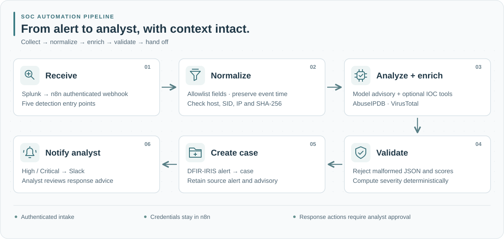
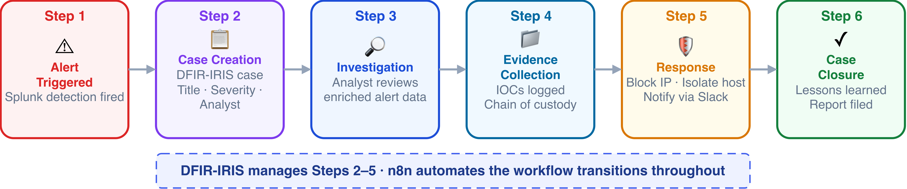
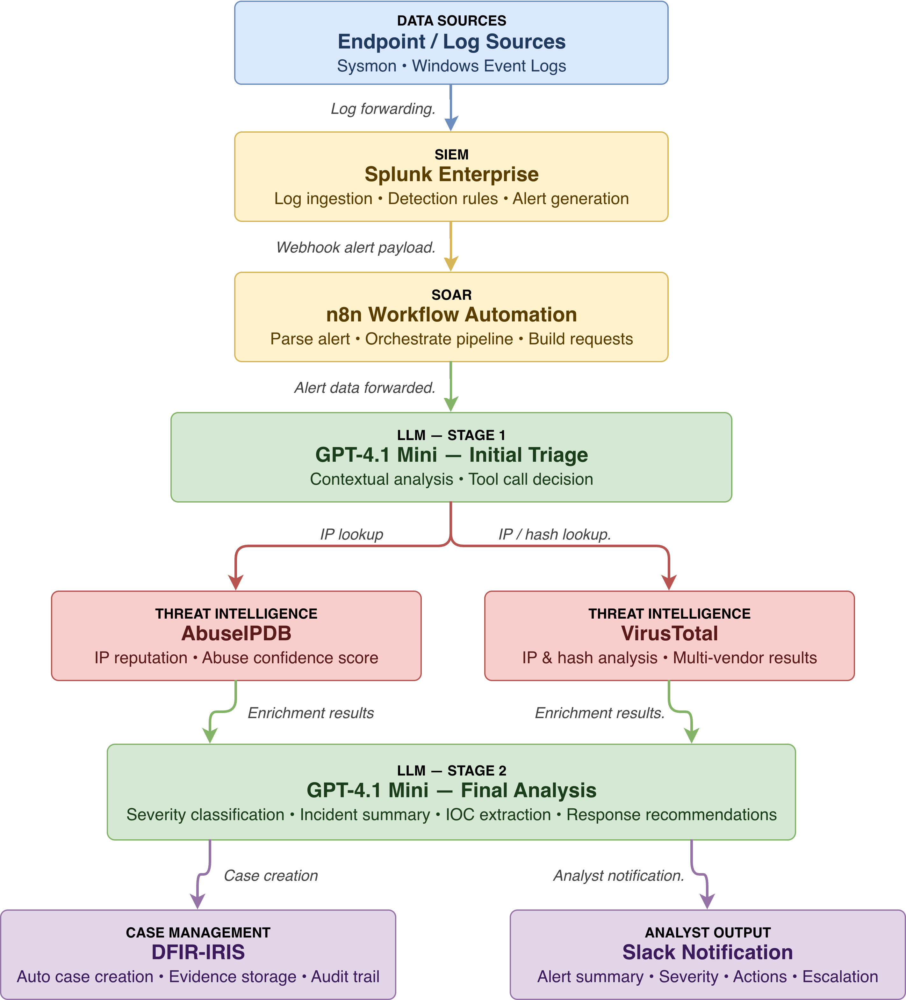
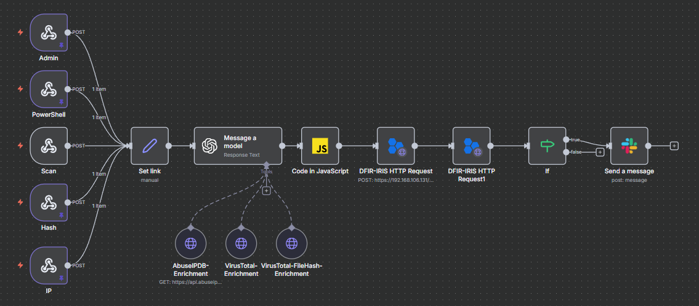
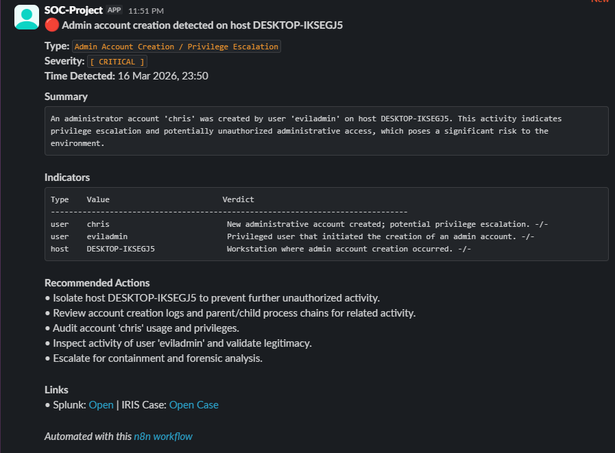
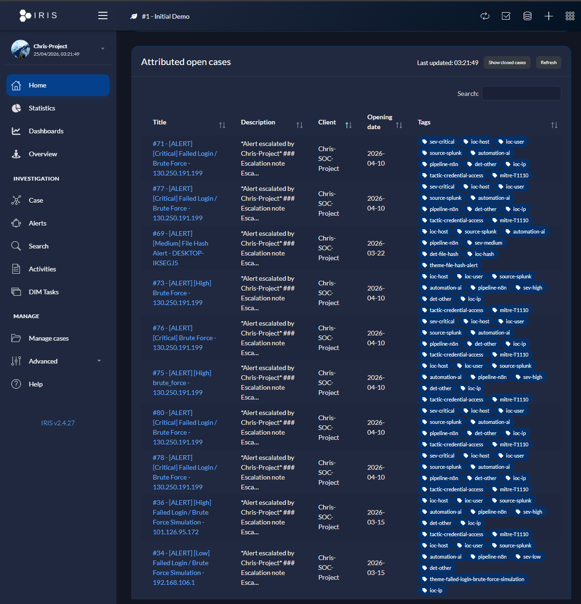
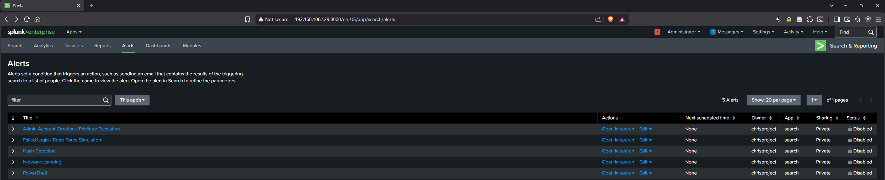
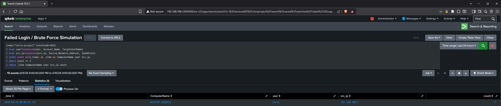

# SOC Automation Pipeline

AI-assisted security operations: telemetry, enrichment, case management and analyst notification.

`Splunk → n8n → GPT-4.1 Mini + AbuseIPDB / VirusTotal → DFIR-IRIS → Slack`

A five-machine lab connects Windows events and Sysmon telemetry to structured triage and an investigation handoff. This repository brings the workflow, five detection scenarios, 15 recorded evaluation runs, screenshots and setup notes into one place.

[Setup](docs/lab-environment.md) · [Detection rules](splunk/detection-rules.md) · [Scenarios](docs/attack-scenarios.md) · [Results](results/README.md) · [Dashboard](results/dashboard.html) · [Prompts and code](docs/prompts-and-code.md)

## Pipeline architecture



[Open full-size architecture](screenshots/pipeline.svg). Authenticated intake, source normalization and output validation keep the original alert traceable through model analysis and the case handoff.

<details>
<summary>Investigation lifecycle and component diagram</summary>



The lifecycle includes analyst-led evidence collection, response decisions and closure. Response recommendations in the workflow require analyst action.



[Full-size component diagram](screenshots/architecture-diagram.png).

</details>

## What the pipeline includes

| Capability | Implementation |
|---|---|
| Five alert inputs | Authentication, hash, scanning, account change and PowerShell webhooks |
| Intelligence enrichment | AbuseIPDB IP reputation; VirusTotal IP and SHA-256 lookups |
| Structured triage | Validated summary, scores, recommendations, source-bound indicators and MITRE suggestions |
| Case management | IRIS alert creation followed by case escalation |
| Investigation context | Original SID/time, indicator detail, detection tags and classification defaults |
| Analyst notification | Formatted Slack output for the High/Critical branch |
| Evaluation | Raw 15-run CSV, methodology, radar, interactive charts and comparison tables |
| Reproducibility | Configuration inventory, readable node code and offline tests |

## Recorded evaluation

The 15-run dataset compares three configurations. Averages below are calculated from the recorded rows.

| Metric | A: Manual | B: AI without tools | C: AI with enrichment |
|---|---|---|---|
| Runs | 5 | 3 | 7 |
| Average triage time | 209.0 s | 130.0 s | 38.1 s |
| Time reduction vs manual | — | 37.8% | 81.8% |
| Action quality / 5 | 3.00 | 4.00 | 4.57 |
| Context quality / 5 | 3.60 | 3.00 | 4.29 |
| Average analyst steps | 6.6 | 3.0 | 3.9 |


[Full-size radar](screenshots/pipeline-comparison-radar.png) · [Raw records and reconciliation](results/README.md) · [Interactive analysis](results/dashboard.html).

The preserved radar uses the recorded evaluation's original scales. The CSV supports the time, quality and step calculations; accuracy has no per-run column. The results page explains the difference between the earlier prose's 3.6 integrated steps and the CSV mean of 3.9, plus four timing mismatches.

## Pipeline in action

### n8n workflow



Five input routes converge on model analysis, tool enrichment and downstream handoff. The current export also includes the shared normalization node. [Full-size canvas](screenshots/workflow-canvas.png).

### Slack notification



The analyst receives a concise summary and investigation context. The export sends this branch after IRIS escalation for High/Critical scores. [Full-size Slack capture](screenshots/slack-notification.png).

### DFIR-IRIS case


The alert payload preserves the original source SID, event time, report and indicator context. [Full-size case](screenshots/dfir-iris-case.png).

### DFIR-IRIS queue



The queue groups investigations with severity, source and indicator tags. [Full-size queue](screenshots/dfir-iris-cases-list.png).

## Lab environment

| Machine | Recorded OS | Role | Address |
|---|---|---|---|
| Windows client | Windows 10 Pro | Endpoint telemetry and test target | 192.168.106.128 |
| Splunk | Ubuntu 24.04 | Search and alerts | 192.168.106.129 |
| n8n | Ubuntu 24.04 | Orchestration and model tools | 192.168.106.130 |
| DFIR-IRIS | Ubuntu 24.04 | Case management | 192.168.106.131 |
| Kali Linux | Rolling release | Authorized scenario traffic | 192.168.106.133 |


[Full-size lab overview](screenshots/vmware-lab-overview.png) · [Full-size network settings](screenshots/vmware-network-config.png) · [Network topology](screenshots/lab-network-topology.png).

The private lab segment contains scenario traffic. Model, intelligence and messaging APIs require controlled egress. [Lab setup and communication paths](docs/lab-environment.md).

## Three pipeline configurations

**A — Manual:** review Splunk, look up indicators, assess the alert and document the investigation manually.

**B — AI without tools:** use model analysis without the three enrichment tools. Prepare a separate workflow copy, disconnect the tool connections and adjust the prompt. Inspect traces to confirm no tool calls occurred.

**C — Integrated:** use the supplied [pipeline-c.json](workflows/pipeline-c.json), bind credentials and review the field contract before activation.

The recorded model-only group covers three scenarios; manual and integrated groups cover all five. The [evaluation coverage table](docs/attack-scenarios.md#recorded-evaluation-coverage) gives the actual run counts.

## Attack scenarios

| Scenario | Detection telemetry | Input route |
|---|---|---|
| Authentication failures | Windows Security 4625 | IP |
| Process hash review | Sysmon process creation with SHA-256 | Hash |
| Network service discovery | Windows Firewall drops and ports | Scan |
| Account creation / group change | Windows Security 4720 / 4732 | Admin |
| PowerShell command-line review | Sysmon image, command and parent process | PowerShell |

[Scenario details](docs/attack-scenarios.md) · [Recorded SPL queries](splunk/detection-rules.md) · [Validated deployment examples](splunk/validated-inputs.md).

### Splunk saved alerts



### Authentication search



### Account-change search


### Endpoint telemetry


[Full-size alerts](screenshots/splunk-alerts.png) · [Authentication search](screenshots/splunk-brute-force-detection.png) · [Account search](screenshots/splunk-admin-detection.png) · [Event Viewer](screenshots/sysmon-event-viewer.png).

## Reading the results

Enrichment supplies external indicator context beyond the alert text. The integrated records combine shorter triage times with higher recorded context scores. Model-only runs have fewer steps partly because they omit intelligence lookups.

The experiment has unequal scenario coverage, few repetitions, manual timing and single-evaluator quality scores. Treat its averages as a description of those records. [Methodology, scoring and limitations](results/README.md).

## Setup and validation

1. Prepare the lab services and telemetry sources using [lab-environment.md](docs/lab-environment.md).
2. Copy [env.example](env.example) to a private configuration file and bind credentials in n8n.
3. Run the local suite, import the workflow inactive and configure trusted URLs, IDs and the Slack channel.
4. Follow the controlled acceptance sequence and trace one alert across the services.

```bash
node --test tests/offline.test.cjs
```

The offline suite covers parsing, indicators, score boundaries, payloads, workflow connections and embedded-code consistency. Read [prompts-and-code.md](docs/prompts-and-code.md) for the exact current prompt and readable node sources.

For the interactive charts, download the complete repository and open `results/dashboard.html`. The dashboard has no external scripts, keys or network dependencies. [docs/overview.html](docs/overview.html) provides a separate static architecture and deployment overview.

## Alternative deployments

| Layer | Alternatives discussed in the original study | Adaptation needed |
|---|---|---|
| SIEM | Wazuh, Elastic, Security Onion, Sentinel | Field mapping, detection language and alert delivery |
| Model | Ollama with a local model, other hosted providers | Model-node adapter, tool use and schema validation |
| Orchestration | Shuffle, StackStorm, other SOAR platforms | Rebuild workflow, credential binding and API handoff |

These are porting options; the included export targets n8n and the documented services.

## Repository structure

```text
SOC-Automation-Pipeline/
├── .gitattributes
├── .gitignore
├── .markdownlint.json
├── README.md
├── LICENSE
├── env.example
├── docs/
│   ├── attack-scenarios.md
│   ├── lab-environment.md
│   ├── prompts-and-code.md
│   ├── walkthrough.md
│   └── overview.html
├── results/
│   ├── README.md
│   ├── evaluation-results.csv
│   ├── dashboard.html
│   └── dashboard.js
├── screenshots/
│   ├── pipeline.svg
│   ├── architecture-diagram.png
│   ├── incident-response-workflow.png
│   ├── pipeline-comparison-radar.png
│   ├── workflow-canvas.png
│   ├── slack-notification.png
│   ├── dfir-iris-case.png
│   ├── dfir-iris-cases-list.png
│   ├── splunk-alerts.png
│   ├── splunk-brute-force-detection.png
│   ├── splunk-admin-detection.png
│   ├── sysmon-event-viewer.png
│   ├── lab-network-topology.png
│   ├── vmware-lab-overview.png
│   └── vmware-network-config.png
├── splunk/
│   ├── detection-rules.md
│   └── validated-inputs.md
├── workflows/
│   ├── pipeline-c.json
│   ├── normalize-alert.js
│   └── format-report.js
└── tests/
    ├── example-alert.json
    └── offline.test.cjs
```

## Technology stack

`Splunk` · `n8n` · `OpenAI` · `AbuseIPDB` · `VirusTotal` · `DFIR-IRIS` · `Slack` · `VMware` · `Windows` · `Sysmon` · `JavaScript` · `HTML/CSS`

## Credits and lab context

Jayanth K describes this as shared lab work completed alongside Christopher Andrews on the same machine. The original [LARA SOC Automation publication](https://github.com/C-Andr3ws/lara-soc-automation/tree/41866043d4581ed85d4e921d26bb5e42625af299), recorded captures and evaluation dataset are credited to Christopher Andrews. Reuse follows the MIT license; the required copyright and permission notices remain in [LICENSE](LICENSE).

The screenshots, diagrams and raw CSV retain the recorded identities, IP addresses, timestamps and technical values. They document the historical setup and can differ from the hardened deployment export. Jayanth K's publication includes revised documentation, input/output validation, offline tests, the icon-based architecture and the local interactive dashboard.

The recorded lab evaluation and this publication update are separate activities. This update checked files, links, data calculations and offline code behavior; it did not repeat a live Splunk/n8n/IRIS integration run. The CSV remains unchanged, and reconciliation notes identify differences from the earlier published aggregates. The illustrative SVG and synthetic test fixture explain the deployment version.

Documentation updated 16 October 2026.
