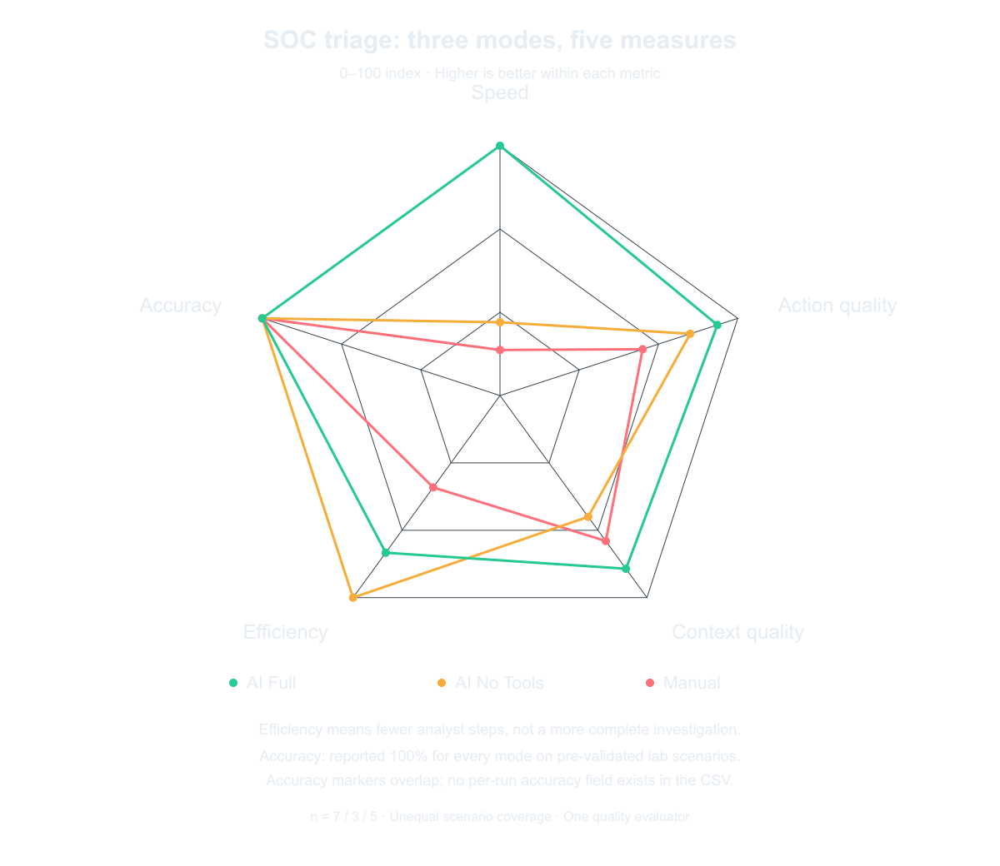

# SOC Automation Pipeline

### AI-assisted SOC triage and analyst handoff

> Splunk → n8n → GPT-4.1 Mini → AbuseIPDB + VirusTotal → DFIR-IRIS → Slack

Built by **Jayanth K** in a personal SOC lab. This project connects alert detection, intelligence-assisted analysis, case management and analyst notification, then compares the recorded results against manual triage and model-only analysis.

## Pipeline Architecture


The pipeline receives an alert, preserves its source context, analyzes eligible indicators and prepares a structured case handoff. Investigation and response decisions remain with the analyst.

## What makes this different

The project measures how three triage configurations compare in **time, investigation context and analyst effort**. The evaluation contains **15 recorded runs across five scenarios**, with 5 manual, 3 model-only and 7 integrated runs.

| Metric | Manual baseline | Model only | Fully integrated |
|---|---|---|---|
| Average triage time | 209.0 s | 130.0 s | 38.1 s |
| Recorded time reduction vs manual | — | 37.8% | 81.8% |
| Action quality / 5 | 3.00 | 4.00 | 4.57 |
| Context quality / 5 | 3.60 | 3.00 | 4.29 |
| Average analyst steps | 6.6 | 3.0 | 3.9 |

The integrated configuration combined the shortest recorded mean time with the highest context score. Its recorded analyst-step count was **41.6% lower than manual triage**; the model-only mode used fewer steps because it omitted enrichment lookups.

> These are descriptive lab comparisons with unequal scenario coverage. [Full methodology, timing notes and interactive results](results/README.md).



*Radar indices summarize the recorded comparison. The accuracy axis reflects the original reported result; the CSV has no per-run classification labels. [All comparison graphics](results/README.md#experiment-visuals).*

## Pipeline in Action

### n8n Workflow Canvas


*Recorded experiment canvas. The included [reference export](workflows/pipeline-c.json) uses `Normalize alert` in place of `Set link`. [Full-size canvas](screenshots/workflow-canvas.png).*

### Analyst notification and case

<table>
<tr><th align="left" width="50%">Slack notification</th><th align="left" width="50%">DFIR-IRIS case</th></tr>
<tr>
<td valign="top"><a href="screenshots/slack-notification.png"></a></td>
<td valign="top"><a href="screenshots/dfir-iris-case.png"></a></td>
</tr>
</table>

*Recorded application views; click either image for full resolution. The captured Slack formatting belongs to that experiment version; [formatter source](workflows/format-report.js) describes the included code.*

### Investigation queue


*Case priorities, source tags and investigation context. [Full-size queue](screenshots/dfir-iris-cases-list.png).*

## Lab environment

The experiment uses Windows telemetry and dedicated SIEM, orchestration, case-management and test roles within the personal lab.

### Component architecture


*Conceptual architecture. The [export reference](docs/current-workflow.md) documents the actual included node order.*

### Virtual machines


### Virtual network configuration


### Network topology


[Machine roles, communication paths and setup procedure](docs/lab-environment.md)

## Detection and endpoint evidence

### Saved Splunk alerts


### Authentication failures


### Account changes


### Sysmon telemetry


The [SPL examples](splunk/detection-rules.md) use `index=jayanth-project`. The [input contract](splunk/validated-inputs.md) documents the fields supplied to each route. Captured interfaces retain their original values.

## Investigation lifecycle


*The wider investigation includes analyst review, evidence collection, response choices and closure. These analyst activities are separate from the exported automation nodes.*

### Alternate pipeline view


## Project Structure

The main project folders follow the same flow as the lab:

```text
SOC-Automation-Pipeline/
├── docs/          # Lab setup, workflow and code explanations
├── results/       # Recorded evaluation, charts and dashboard
├── screenshots/   # Architecture, lab and execution images
├── splunk/        # Detection queries and alert input examples
├── workflows/     # n8n export and JavaScript node sources
├── LICENSE
├── README.md
└── env.example
```

Supporting checks are in `tests/`, `scripts/`, `data/` and `.github/`.

## Skills demonstrated

| Skill | Applied project work |
|---|---|
| Detection engineering | SPL searches for authentication failures, process hashes, scanning, account changes and PowerShell |
| Endpoint investigation | Windows Security and Sysmon context, users, parent processes, command lines and SHA-256 indicators |
| Workflow automation | Authenticated n8n webhooks, normalization, model/tool orchestration and downstream API requests |
| Threat-intelligence triage | Source-bound AbuseIPDB and VirusTotal lookups with analyst interpretation |
| Secure JavaScript | Input contracts, identity checks, bounded model responses, Slack escaping and pinned ATT&CK mapping validation |
| Case communication | Structured IRIS advisory payloads, case tags and analyst-facing Slack notifications |
| Engineering quality | Regression tests, source-generated workflow code, canonical chart data and CI checks |

## Source and reproduction

| Reference | Contents |
|---|---|
| [n8n export](workflows/pipeline-c.json) | Inactive, credential-free workflow reference |
| [Normalizer](workflows/normalize-alert.js) | Event context, identity, timestamp and indicator checks |
| [Formatter](workflows/format-report.js) | Report parsing, ATT&CK checks and downstream payload construction |
| [Prompt and code guide](docs/prompts-and-code.md) | Model contract and included source behavior |
| [Lab setup](docs/lab-environment.md) | Service configuration and execution procedure |
| [Tests](tests/offline.test.cjs) | Reproducible software checks; CI runs on push and pull requests |

Use Node.js 24 to run the complete checks:

```bash
node scripts/check.cjs
```

Import the reference export inactive and bind credentials, URLs, tenant mappings and Slack routing in the target lab. `env.example` lists the configuration; importing the workflow does not automatically load it. In the included graph, IRIS escalation precedes the severity branch and High/Critical controls Slack. Model scores are advisory.

<a id="credits-and-lab-context"></a>

## Author and lab context

**Jayanth K** built the project, configured the personal lab and completed the recorded experiment. Later source hardening includes AI-assisted code and documentation revisions. The original dataset and image files are preserved; capture and documentation review date: **16 October 2026**, as confirmed by Jayanth K. Application event/case timestamps remain unchanged.

[MIT license](LICENSE) · [Image inventory and checksums](screenshots/manifest.csv) · [Lab walkthrough](docs/walkthrough.md)
