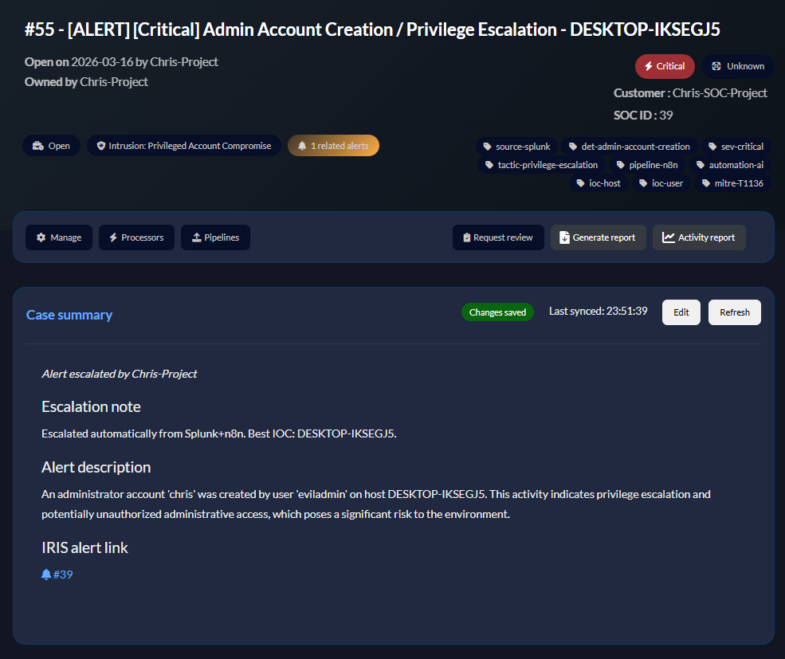

# From Alert to Analyst Handoff

[Home](README.md) · [Setup](SETUP.md) · [Detections](DETECTIONS.md)

## Workflow canvas


Five alert types converge on a shared analysis path. The reboot adds normalization ahead of model analysis and validates the report before downstream requests. [View full-size canvas](images/workflow-canvas.png).

## Case handoff



IRIS provides a place to retain the original alert and analyst-facing summary. The reboot carries the original source SID and event timestamp into its alert payload and tags the model advisory for review. [View full-size case](images/dfir-iris-case.png).

## Analyst notification


The High/Critical branch sends a concise Slack message after case escalation. Lower scores still reach IRIS but do not take that Slack branch. Model recommendations are text for analyst review, not executed response commands. [View full-size notification](images/slack-notification.png).

## A reproducible local check

The [example alert](tests/example-alert.json) exercises normalization with a private client IP, a dedicated lab identity and a timezone-qualified event time. The tests supply a fixed model response to make the formatter deterministic, then verify the resulting severity and IRIS fields. Read the code in [normalize-alert.js](workflows/normalize-alert.js) and [format-report.js](workflows/format-report.js) alongside their embedded n8n nodes.

```bash
node --test tests/offline.test.cjs
```

To review a real integration, retain the Splunk SID, n8n execution ID, tool results, IRIS alert/case IDs and downstream delivery status. Those identifiers let you trace one alert across the entire handoff without inferring success from a screenshot alone.
