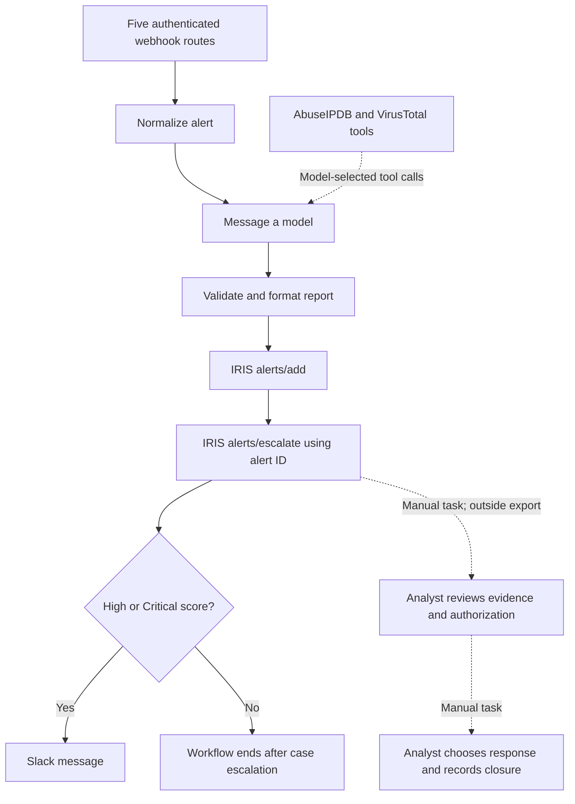

# Current Workflow and Analyst Boundaries

[Home](../README.md) · [Export](../workflows/pipeline-c.json) · [Setup](lab-environment.md)

This conceptual diagram is derived from the exported connections. It is an explanation of code structure, not a screenshot or proof of execution. Original captures predate the current normalization stage.

**Unresolved policy:** the export attempts case escalation before severity branching. It has no implemented approval gate or Low/Medium review queue. The user has not selected the case policy. Do not describe the current graph as High/Critical-only case creation or activate it on that assumption.

The model score is advisory and is not a calibrated probability. Source-bound tools constrain requested indicators, but the model selects whether to invoke them. Deterministic enrichment, a durable delivery state store, recovery/reconciliation, complete deployment configuration and verified native IRIS entity creation remain incomplete. A webhook success response is not an end-to-end delivery acknowledgement.

Investigation, containment, evidence collection beyond the supplied event, and closure are analyst activities outside this export. No node blocks an IP, isolates a host or disables an account. Exact installed versions and current live execution results remain unknown. Offline regression tests and CI cannot replace controlled acceptance evidence.
