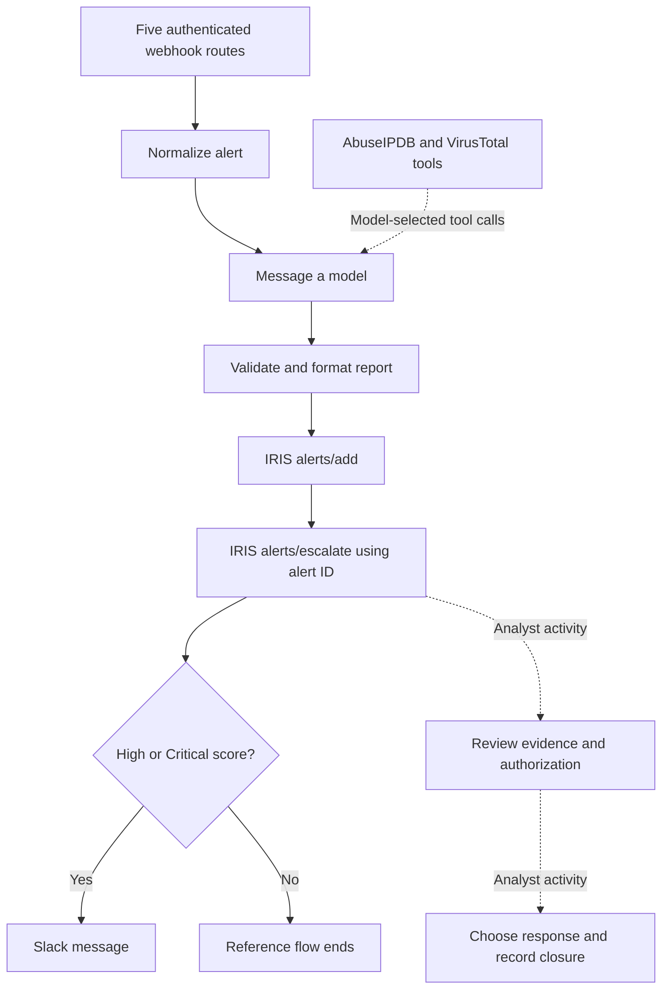

# Exported Workflow Reference

[Home](../README.md) · [Export](../workflows/pipeline-c.json) · [Lab setup](lab-environment.md)

The personal lab executions and documentation are complete. This diagram describes the node connections in the included `pipeline-c.json` reference export. It is a source-code diagram; the recorded interface images are available in the [lab walkthrough](walkthrough.md).

In this exported file, IRIS escalation precedes the severity branch; High/Critical controls the Slack branch. The three intelligence nodes connect as model-selected tools. The model's numeric scores are advisory judgments rather than calibrated probabilities.

[normalize-alert.js](../workflows/normalize-alert.js) preserves source identity, event context and eligible indicators. [format-report.js](../workflows/format-report.js) parses a bounded report and constructs the downstream payloads. The export stays inactive and contains no credential bindings so it can be configured for a target lab.

Investigation and response decisions are analyst activities. The diagram and source links describe exactly the contents of the included reference files.

**Capture and documentation review date:** 16 October 2026, as confirmed by Jayanth K. Application event and case timestamps remain unchanged.
