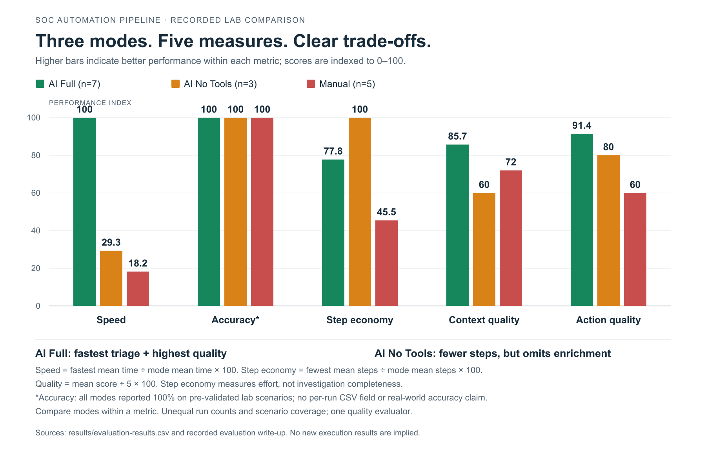

# Lab Experiment Results

[Home](../README.md) · [Raw CSV](evaluation-results.csv) · [Interactive dashboard](dashboard.html) · [Scenarios](../docs/attack-scenarios.md)

These 15 CSV rows record the experiment completed by **Jayanth K** in a personal SOC lab. The dataset and screenshots document the original experiment. See [project and lab context](../README.md#credits-and-lab-context).

The [dashboard](dashboard.html) computes the recorded experiment results. Lab executions and documentation are complete. Screenshot capture and documentation review date: **16 October 2026**, confirmed by Jayanth K. The published measurements below are retained without alteration.

## Method

The evaluation compares manual triage (A), model analysis without intelligence tools (B), and integrated orchestration with intelligence tools (C). It covers five scenarios; B has only authentication, file-hash and scanning records.

The recorded `triage_time_s` value represents the reported end-to-end timing. The start/end columns are also retained, but do not consistently reconstruct that duration. No timestamp or measured duration has been rewritten.

Action and context quality use a five-point rubric:

| Score | Action quality | Context quality |
|---|---|---|
| 1 | Irrelevant or incorrect | Missing or incorrect context |
| 2 | Partially useful | Major contextual gaps |
| 3 | Correct but generic | Basic interpretation |
| 4 | Useful and specific | Good contextual explanation |
| 5 | Specific and well-supported | Rich explanation with relevant validation |

The recorded evaluation uses one evaluator assigning qualitative scores; the later code remediation has not re-scored those cases. Analyst steps count discrete actions in the triage workflow.

## Overall results

Integrated triage has the lowest recorded mean time and the highest mean context score. Model-only analysis is faster than manual review in these records but has a lower mean context score. That is why the comparison includes quality and effort alongside speed.

The values below are calculated from each mode's available CSV rows.

| Mode | Runs | Mean triage time | Action / 5 | Context / 5 | Analyst steps |
|---|---|---|---|---|---|
| A: Manual | 5 | 209.0 s | 3.00 | 3.60 | 6.6 |
| B: AI without tools | 3 | 130.0 s | 4.00 | 3.00 | 3.0 |
| C: AI with enrichment | 7 | 38.1 s | 4.57 | 4.29 | 3.9 |

Relative to the manual average, the recorded model-only time is 37.8% lower and the integrated time is 81.8% lower. These are descriptive comparisons from the original lab experiment, with differently sized groups. They do not establish causal or production improvements. The same recorded measurements are used consistently across the tables, CSV and dashboard.

## Experiment visuals

These preserved graphics show the original experiment comparison. **Their accuracy axis is not supported by per-run labels or predictions in the CSV.** Use the numerical tables and [dashboard](dashboard.html) for directly computable metrics; these images do not establish current accuracy or production performance.

<picture>
  <source media="(prefers-color-scheme: dark)" srcset="../screenshots/triage-comparison-dark.png">
  
</picture>

*Original experiment comparison graphic. [Light version](../screenshots/triage-comparison.png) · [Dark version](../screenshots/triage-comparison-dark.png). Speed and step-economy indices have different meanings; polygon area does not measure investigation quality.*

<strong>View the original lab evaluation radar</strong>

*Original graphic retained unchanged. Its accuracy claim cannot be verified from the CSV. [Open full size](../screenshots/pipeline-comparison-radar.png).*

All originals remain intact; capture details and checksums are recorded in the [manifest](../screenshots/manifest.csv).

## Results by scenario

| Scenario | Integrated | Model only | Manual |
|---|---|---|---|
| Brute Force | 43.0 s | 160.0 s | 210.0 s |
| File Hash | 40.5 s | 120.0 s | 220.0 s |
| Network Scanning | 35.2 s | 110.0 s | 260.0 s |
| PowerShell | 34.0 s | — | 185.0 s |
| Admin Privilege Escalation | 30.6 s | — | 170.0 s |

## Reconciliation notes

- The integrated group contains 27 analyst steps across seven runs: `27 / 7 = 3.857…`, displayed as 3.9. The earlier published prose reports 3.6; the raw rows are preserved and the dashboard computes 3.9.
- Runs 1, 3, 6 and 7 have durations that differ from end minus start. The dashboard displays both values and flags those rows rather than substituting a guessed time. See the exact discrepancies below.
- The original statement of 100% classification accuracy is reported in the original write-up, but has no accuracy column in the CSV. It is not recomputed here.
- Counts and quality scores describe a small controlled dataset with unequal scenario coverage, single-evaluator scoring and manually recorded times.

## Reading the comparison

Enrichment can supply indicator context that a model cannot obtain from an alert alone. Fewer analyst steps in mode B also reflect omitted lookups, so step count alone is not a complete measure of investigation quality.

Retain the full raw records when interpreting a graph. The [lab execution sequence](../docs/lab-environment.md#4-controlled-acceptance-test) describes the source-to-handoff process.

## Timing discrepancies retained

| Run | Recorded triage seconds | End minus start seconds | Difference (recorded minus timestamps) |
|---|---|---|---|
| 1 | 39 | 15 | +24 |
| 3 | 41 | 15 | +26 |
| 6 | 35.2 | 10 | +25.2 |
| 7 | 30.6 | 7 | +23.6 |

Both recorded duration and clock differences are retained without substituting a corrected value. The published figures use the recorded triage duration column consistently; the timestamp differences are shown for transparency.
